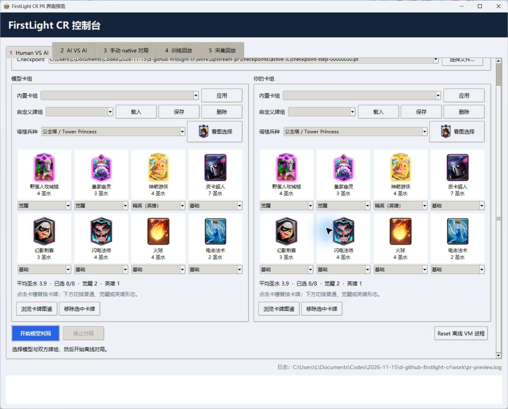
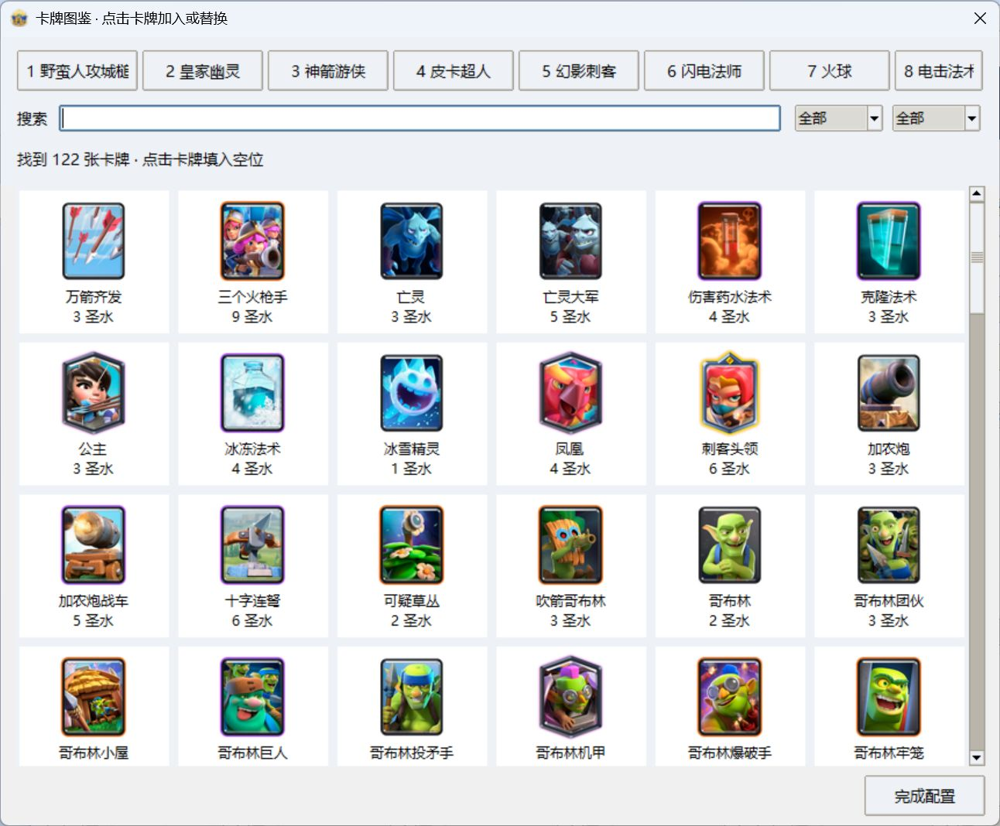

# Checks

[English home](../README.md) · [Training](training.md)

Use these checks after installation, when changing an engine or checkpoint, and before starting a training run.

## Python and models

Run from the repository root after installing the dependencies:

```sh
python -m pip check
python tools/check_install.py
```

`pip check` should report no dependency conflicts. `check_install.py` verifies the data hashes, loads each included checkpoint, and prints `Ready: 5 models` when successful.

## Tests

```sh
python -m pip install pytest
python -m pytest native_runner/tests -q
```

The tests cover environment contracts, card mechanics, observations and actions, native layouts, cache encoding, IL/PPO updates, and model serving. Set `CR_INPUT_APK` to enable original-APK fingerprint checks. CUDA tests need a CUDA device, and native C++ tests need `g++`; tests with unavailable prerequisites are skipped.

## Native engine

### Offline duel modes





The deck editor shows eight illustrated slots. Click a slot to replace it using
the searchable card palette, or browse the palette to fill an empty slot.
Filters cover card type and elixir cost. Existing selections are highlighted;
duplicate selections are blocked. Form selectors use each card's supported
forms, and the deck summary reports average elixir and role counts. Tower troops
also have an illustrated selector. Artwork is bundled locally, with text fallback
for missing images; its source notice is in `native_runner/assets/cards`.

Selecting the 7x random-evolution mode deals and previews both decks. Starting the
match preserves that preview; use the random-deck button to explicitly redeal.
Large configuration pages scroll to keep the bottom actions reachable.

The duel interface uses eight-card Friendly rules for 7x elixir and Ramp Up;
event-deck, four-card and All Random mode IDs are not interchangeable with them.
All Evolution uses standard 1v1 rules with evolution availability set for eligible
cards. This does not bypass native evolution cycles. The 7x variant still deals
eight random evolution-capable cards to each side. Elixir Barrels is temporarily
unavailable pending validation of its arena events and model observations.

V4 checkpoints were trained with at most two evolution roles, two hero roles and
three combined. Special decks exceeding this contract retain the existing static
role projection and now emit an explicit warning. Their strategy is experimental;
changing a mode ID cannot remove that training limitation.

AI-versus-AI duels warm up while paused, reset policy state, then advance exactly
five ticks between decisions. This avoids CPU inference causing different game
times for the two actors. On slow hardware playback may run slower than real time.
Decision logs include full decision latency and elixir; results include action
rejections and mean decision latency. Engine failures write their cause into
`result.json` and display it in the interface.

Unit checks do not start a VM or connect to the game:

```powershell
.\.venv\Scripts\python.exe -m pytest native_runner/tests/test_duel_modes.py native_runner/tests/test_training_v4_offline_duel.py native_runner/tests/test_training_v4_policy_session.py native_runner/tests/test_user_interface.py -q
```

Manual acceptance remains separate: with the dedicated VM available, finish a
standard, 7x, Ramp Up and All Evolution match; inspect action rejections and
five-tick decision spacing, then stop/restart and switch modes. Do not run this
acceptance while the VM is in use by another project.

Prepare the VM using the [installation guide](getting_started.md), then run:

```powershell
.\launch_interface.cmd --diagnose
.\launch_interface.cmd
```

Check that the configured VM is found, a match starts at level 11, and both manual and model actions execute. When diagnosing a problem, use `runs/interface/firstlight-interface.log` together with the build and installation receipts.

## Replays and training

The [training guide](training.md) provides commands for each step. Check the corresponding outputs before moving to the next step:

| Step | Check |
| --- | --- |
| Replay reconstruction | Actions execute in order and playback reaches the source endpoint |
| IL cache | Completed/failed replay counts, expert/executed action counts, and `--verify-roundtrip` result |
| IL training | Finite loss, advancing training groups, and a checkpoint that loads |
| Linux guests / Linux guest | Readiness checks pass for the configured engines and capacities |
| PPO training | Rollouts complete, optimizer updates finish, and checkpoints are saved |

For a new distributed setup, run the one-update PPO example first and check each simulation node’s readiness report and the trainer output. For model comparisons, inspect the outcome and execution metrics described in [model evaluation](../checkpoints/README.md).

## Repository files

Before publishing repository changes, run:

```sh
python tools/check_release.py
```

This checks the distribution file set, included checkpoint and data hashes, configuration template, and ignore rules. A successful result ends with `0 errors`.
